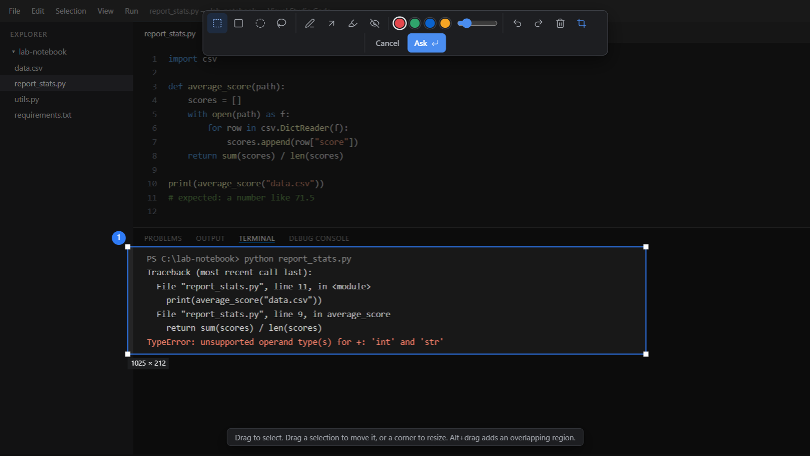
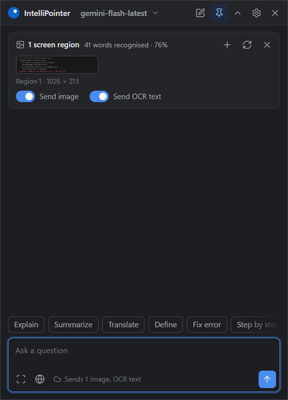
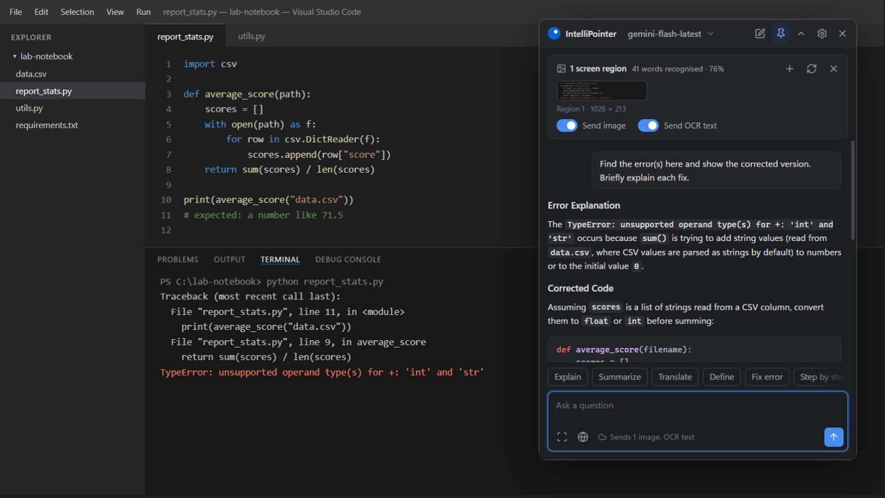
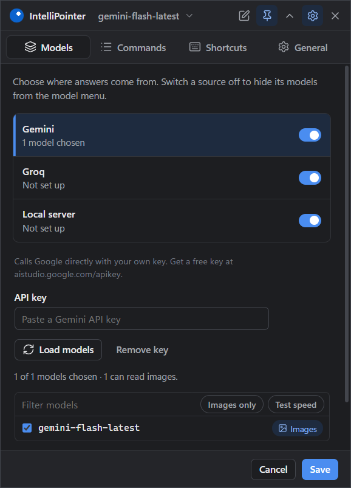

<p align="center">
  
</p>

<h1 align="center">IntelliPointer AI</h1>

<p align="center">
  <b>Mark anything on your screen, ask an AI about it, get a streamed answer.</b><br>
  A lightweight Windows assistant with local OCR, your own API keys, and automatic updates.
</p>

<p align="center">
  <a href="https://github.com/WillyEverGreen/Intelli-Pointer-AI/releases/latest"></a>
  <a href="https://github.com/WillyEverGreen/Intelli-Pointer-AI/actions"></a>
  
  
</p>

---

## Download

**[Download the latest installer](https://github.com/WillyEverGreen/Intelli-Pointer-AI/releases/latest)** (`IntelliPointer-AI-Setup-x.y.z.exe`) and run it. It installs for your user only, with no admin rights, and adds Desktop and Start-menu shortcuts.

**Updates are automatic.** The installed app checks GitHub Releases shortly after it starts and every few hours. A newer version downloads in the background and installs when you quit the app, or right away from the tray menu (**Restart to update**). You never need to download the installer again. Settings → General → Updates has a **Check for updates** button and a switch to turn automatic updates off.

> The installer is not code-signed, so Windows SmartScreen may show "Windows protected your PC" the first time. Choose **More info → Run anyway**.

## What it does

You never have to take a screenshot, open a chatbot, paste and re-explain. Press a shortcut, the screen freezes, you mark one or more regions, local OCR reads them, and a floating panel streams the answer.

| 1. Mark the problem | 2. Local OCR reads it |
| :---: | :---: |
|  |  |
| The screen freezes instantly. Mark a region with the rectangle, ellipse or lasso tool, and add arrows, pen, highlight or blur. | The crop is read on your PC. Before sending, the panel states exactly what will leave it: the image and the OCR text. |

| 3. Streamed answer | 4. Your models, your keys |
| :---: | :---: |
|  |  |
| "Fix error" returns the cause and corrected code beside the original screen. | Use Gemini or Groq with your own key, or any OpenAI-compatible server such as 9Router, Ollama or LM Studio. |

## Features

- **Instant screen capture:** the overlay appears at once and the screenshot is swapped in behind it. Correct under any display scaling and on multiple monitors.
- **Selection tools:** rectangle, square, ellipse, lasso, pen, arrow, highlight and blur; several regions per question; undo and redo.
- **Ask about selected text:** select text in any app and press a shortcut, or click the Ask bar that appears next to the selection.
- **Local OCR:** text is extracted on your PC, so text-only models can answer questions about screenshots.
- **Commands:** Explain, Summarize, Translate, Define, Fix error, Step by step and your own, each with an optional shortcut.
- **Follow-up questions** reuse the same screenshot, and answers stream in with Markdown and code highlighting.
- **Private by design:** nothing is stored. A notice before every send names what will be sent, and local-only mode blocks all uploads.
- **Light on resources:** about 450 MB across its processes at idle and under 1% CPU, with a compiled native helper instead of a PowerShell host.
- **Updates itself** from GitHub Releases.

## Shortcuts and commands

| Shortcut | Does |
|---|---|
| **Alt+Shift+S** | Select a screen region (or several) and ask about it |
| **Alt+Shift+A** | Ask about the text selected in any app |
| Your own | Each command can have a shortcut that runs it on the selected text, or on a screen region when nothing is selected |

If another app already owns a default shortcut, IntelliPointer falls back to an alternative (Ctrl+Alt+S / Ctrl+Alt+A, then Ctrl+Shift+Space / Ctrl+Shift+X) and shows which is active. To pick your own, open **Settings → Shortcuts**, click a shortcut and press the keys. Each combination is checked against other apps before it is saved. The chat window hides when you press any shortcut and comes back with the result.

**Commands** are one-click prompts. Add your own in **Settings → Commands** (name, prompt, optional web search and shortcut) and pin up to four to the screen toolbar and the Ask bar.

## Choosing models

Open **Settings → Models**. Every source has a switch; turn one off to hide its models. Click a source to set it up, and click **Load models** to pick the models you want.

| Source | What you enter | Notes |
|---|---|---|
| **Gemini** | API key from [aistudio.google.com/apikey](https://aistudio.google.com/apikey) | Calls Google directly. All Gemini models read images, and web search is supported. |
| **Groq** | API key from [console.groq.com/keys](https://console.groq.com/keys) | Calls Groq directly. Llama 4 models read images. |
| **Local server** | URL of any OpenAI-compatible server. Presets for **9Router** (`:20128/v1`), **Ollama** (`:11434/v1`) and **LM Studio** (`:1234/v1`), plus an optional key | Plain HTTP is allowed only for this PC or your local network. |

Image support is guessed from the model name and can be corrected with the **Images** toggle; text-only models get OCR text instead. **Local-only mode** (Settings → General) restricts the app to your local server so nothing leaves your network.

## Privacy and security

- **Keys:** provider keys are encrypted with Windows DPAPI under `%APPDATA%\IntelliPointer AI`. Only the app's main process can read them; the UI sees at most the last four characters.
- **Data:** screenshots and conversations stay in memory and are never written to disk. Logs contain only ids, counts and timings, never prompts, OCR text or images.
- **Direct connections:** requests go from your PC straight to the provider you chose. There is no IntelliPointer server in between.
- **Selected text** is read only on your PC, only after a drag or double-click. Password fields are skipped, and nothing is sent until you click an action.
- **Windows:** the UI runs sandboxed with context isolation and a strict CSP, has no browser permissions, can't navigate away, and opens only `https:` links externally. The chat window and Ask bar are excluded from screen capture.
- **Updates:** downloaded from this repository's GitHub Releases and verified against the SHA-512 checksum in `latest.yml`.

Found a vulnerability? Please open a private security advisory on GitHub instead of a public issue.

## Troubleshooting

| Problem | What to try |
|---|---|
| A shortcut does nothing | Another app owns it. Settings → Shortcuts shows which shortcut is active; pick another. |
| No models in the model menu | Settings → Models: add a key or server and click **Load models**. |
| "Gemini returned HTTP 503" | The provider is overloaded. Try again, or pick another model. |
| First OCR is slow | The English OCR model (about 10 MB) downloads once, then works offline. |
| Diagnostics | Tray menu → **Open diagnostics log**. |

## Build from source

Requires Windows 10/11 and Node.js 22 or newer.

```bash
cd desktop
npm install
npm start                 # run from source
npm run check && npm test # syntax check and unit tests
npm run dist              # build the installer into desktop/dist-installer/
```

UI tests need an unlocked screen: `npx electron test/ui.e2e.js`, `test/overlay.e2e.js`, `test/providers.e2e.js`. See [desktop/README.md](desktop/README.md) for the code layout.

## Releasing an update

Users receive updates from GitHub Releases, so publishing a release is all it takes:

1. Raise `version` in `desktop/package.json` (for example `1.0.1`) and commit.
2. Tag and push: `git tag v1.0.1 && git push origin v1.0.1`.
3. The **Release** workflow builds the installer, publishes it with `latest.yml` and the blockmap to a GitHub Release, and every installed copy updates itself.

To publish from your own PC instead, set `GH_TOKEN` and run `npm run release` in `desktop/`.

## License

MIT. See [LICENSE](LICENSE).
