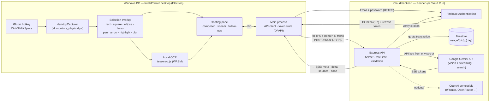

# IntelliPointer AI

Mark anything on your Windows screen, ask an AI about it, and get a streamed answer in a floating panel. You never have to take a screenshot, open a chatbot, paste and re-explain.

- **Desktop app** (`desktop/`, Electron): global hotkey, frozen-screen selection overlay, drawing tools, local OCR, floating composer + response panel.
- **Cloud API** (`backend/`, Node.js + Express): Firebase login check, per-user quota, request validation, AI provider routing, SSE streaming.
- **Firebase** (free Spark plan): Authentication for users, Firestore for per-user usage counters.

## Architecture



**Request lifecycle:**
1. The hotkey triggers a capture of every monitor *before* the overlay appears, so the overlay never ends up in the image.
2. The user marks regions and annotations.
3. The regions are cropped at physical resolution.
4. The panel shows the thumbnails immediately, and OCR runs locally in the background.
5. The user asks a question or clicks a quick action. The panel always states what will be sent.
6. The main process attaches the Firebase ID token and POSTs to `/v1/ask`.
7. The backend verifies the token, reserves quota in a Firestore transaction, validates the images (real file signature, size, count), checks that the model can read images, and streams Gemini's answer back as SSE.
8. Follow-up questions reuse the same screenshot context.

## What works today

| Area | Status |
|---|---|
| Global hotkeys (capture, ask-about-clipboard), tray icon | ✅ |
| Multi-monitor capture, mixed Windows display scaling (crops are taken in physical pixels) | ✅ |
| Rectangle, square (S or Shift), ellipse/circle, freehand lasso | ✅ |
| Move / resize regions, multiple numbered regions per question | ✅ |
| Pen, arrow, highlighter, blur (pixelate sensitive data before sending), undo/redo/clear | ✅ |
| Mask outside circle/lasso shapes (toggle) | ✅ |
| Local OCR (tesseract.js), shown with confidence and timing | ✅ |
| Quick actions: Explain, Define, Summarize, Fix error, Translate, Step by step, Example, Compare, Search web | ✅ |
| Composer: Enter sends, Shift+Enter adds a new line, empty Enter runs the default action; stop; retry; copy | ✅ |
| Streaming Markdown answers with code highlighting; web-search sources (Gemini grounding) | ✅ |
| Follow-up questions reuse the screenshot; "+ Region", "Replace", "New chat" | ✅ |
| Pin/unpin on top, collapse/expand, resize, drag; the panel opens beside the selection, not over it | ✅ |
| Firebase email/password login; refresh token encrypted with Windows DPAPI | ✅ |
| Cloud API: token verification, Firestore quotas, per-user rate limit, image validation, SSE | ✅ |
| Provider abstraction: Gemini + any OpenAI-compatible endpoint, with per-model vision checks | ✅ |
| Latency: capture, OCR, upload size, first token and total time shown per answer and logged to CSV | ✅ |
| Local-only mode (nothing is uploaded), privacy notice before every send | ✅ |
| **Select text in any app → "Ask · Explain · Translate · Define" bar** appears next to it (like a "Reply" popup) | ✅ Windows UI Automation; it never takes focus and hides on the next click elsewhere |
| **Ctrl+Shift+X with text selected** asks about that text (UI Automation → Ctrl+C with the clipboard restored → existing clipboard) | ✅ Ctrl+C is never sent to terminals |
| Per-region text notes, Windows built-in OCR engine, packaged installer signing | 🕒 Planned |

## Quick start (local, about 5 minutes)

Requires Node.js 20 or newer on Windows 10/11.

```bash
# 1) Backend
cd backend
npm install
cp .env.example .env        # then set GEMINI_API_KEY (free from https://aistudio.google.com/apikey)
# For a first local run without Firebase, also set AUTH_DISABLED=true in .env (localhost only)
npm run dev                  # http://127.0.0.1:8080/healthz

# 2) Desktop app (second terminal)
cd desktop
npm install
npm start
```

Then press **Ctrl+Shift+Space**. Drag over something, press **Enter**, and type a question (or click a quick action).

## Choosing models (your own keys, a local server, or the cloud)

Open **Settings → Models**. Each tab is one model source, and you can set up several at once. The model menu in the title bar groups them by source.

| Source | What you enter | Notes |
|---|---|---|
| **Gemini** | API key from aistudio.google.com/apikey | Calls Google directly. All Gemini models read images, and web search is supported. |
| **Groq** | API key from console.groq.com/keys | Calls Groq directly. Llama 4 models read images. |
| **Local server** | URL of any OpenAI-compatible server. Presets for **9Router** (`:20128/v1`), **Ollama** (`:11434/v1`) and **LM Studio** (`:1234/v1`), plus an optional key | Plain HTTP is allowed only for this PC or your local network (`10.x`, `192.168.x`, `172.16–31.x`, `*.local`). |
| **Cloud** | Backend URL, Firebase key, sign-in | Your deployed IntelliPointer API, with quotas and server-held keys. |

To set up a source, click **Load models**. Tick the models you want in the menu (a few sensible ones are pre-selected), and use the **Images** toggle to say whether a model can read screen captures. Image support is guessed from the model name, so correct it if the guess is wrong. Text-only models get OCR text instead of images.

**Key safety:**
- Provider keys are encrypted with Windows DPAPI (`%APPDATA%\IntelliPointer AI\provider-keys.bin`).
- They are used only by the app's main process. The UI only ever sees the last four characters.
- Direct providers are called from your PC, so the cloud backend never sees those keys.

**Local-only mode** restricts the app to local-server models, so nothing leaves your network.

## Install as a Windows app (and update it after changes)

```bash
cd desktop
npm run app:install
```

Or double-click **`Update IntelliPointer.cmd`** in the repo root. The same command does a first install and every later update:
1. Runs the unit tests and stops if any fail.
2. Regenerates the icon bundle and the `.exe` icon, and stamps the version and git commit.
3. Packages the app with `@electron/packager` into `desktop/dist/`. The first run downloads the Electron runtime, about 100 MB.
4. **Smoke-tests the build:** it starts the exe with `--smoke-test` (no tray, hotkeys or selection helper) and checks that every window, icon, library and the OCR engine loaded without errors. A broken build is never installed.
5. Closes the running copy, replaces `%LOCALAPPDATA%\Programs\IntelliPointer AI` (no admin rights needed), and refreshes the **Desktop** and **Start menu** shortcuts. It reads each shortcut back to confirm it points at the installed exe.
6. Smoke-tests the installed app again, launched from the shortcut's target.
7. Starts the new version. Add `-- --no-launch` to skip this, or `-- --skip-tests` for a faster rebuild.

Settings, sign-in and the latency log live in `%APPDATA%\IntelliPointer AI`, so they survive updates. **Settings → Privacy and diagnostics** shows the installed version and build commit; `+changes` means it was built from uncommitted work. `npm run app:build` only builds into `desktop/dist/` without installing.

**If a shortcut doesn't respond:** another app may already own it. The panel then shows a warning, and you can pick another shortcut in Settings. Otherwise, open **Settings → Privacy and diagnostics → Diagnostics log**. It records each key press, which method found the selected text and how long it took, and any error. It never stores the text itself.

To uninstall, quit from the tray, then delete `%LOCALAPPDATA%\Programs\IntelliPointer AI` and the two shortcuts.

## Cloud setup (Firebase + Render, free tiers)

### 1. Firebase project (Spark / free plan)
1. Go to https://console.firebase.google.com, choose **Add project**, and turn Analytics off.
2. Go to **Build → Authentication → Get started → Sign-in method**, and enable **Email/Password**.
3. Go to **Build → Firestore Database → Create database** (production mode, any region). Under **Rules**, paste [`firebase/firestore.rules`](firebase/firestore.rules) and click **Publish**. These rules deny all direct client access.
4. Go to **Project settings → General** and note the **Project ID** and **Web API key**. The web API key is public by design: it identifies the project but grants nothing on its own.
5. Go to **Project settings → Service accounts → Generate new private key**. This downloads a JSON file. **Keep it secret** and never commit it (`.gitignore` already blocks `serviceAccount*.json`).

### 2. Deploy the API on Render
1. Push this repository to GitHub (private is fine).
2. On https://render.com choose **New → Blueprint** and select the repo. Render reads [`render.yaml`](render.yaml).
3. Fill in the secret environment variables when asked:
   - `FIREBASE_PROJECT_ID`
   - `FIREBASE_SERVICE_ACCOUNT_JSON`: paste the whole JSON on one line, or base64 it with `[Convert]::ToBase64String([IO.File]::ReadAllBytes("key.json"))`
   - `GEMINI_API_KEY`
4. After the deploy, `https://<your-service>.onrender.com/healthz` should show `{"ok":true,"providers":true,"quota":"firestore"}`.

> The free Render plan sleeps after 15 minutes idle, and the first request after that takes about 30–50 s while it wakes. Open `/healthz` once before a demo. The same `backend/Dockerfile` also deploys to Google Cloud Run if you have billing enabled.

### 3. Point the desktop app at the cloud
Open the panel and click ⚙ **Settings**:
- **Backend URL**: `https://<your-service>.onrender.com`. HTTPS is enforced for any non-localhost URL.
- **Firebase Web API key**: from step 1.4.

Then click **Create account** (first time) or **Sign in**. The panel's model list fills from the backend.

## Environment variables (backend)

Every variable is documented in [`backend/.env.example`](backend/.env.example). The important ones:

| Variable | Purpose |
|---|---|
| `FIREBASE_PROJECT_ID` | Required. Used to verify user ID tokens. |
| `FIREBASE_SERVICE_ACCOUNT_JSON` | Enables Firestore quotas. Without it, quotas are kept in memory and reset on restart. |
| `GEMINI_API_KEY`, `GEMINI_MODELS` | Gemini provider. Defaults to `gemini-flash-latest,gemini-flash-lite-latest`. |
| `OPENAI_COMPAT_BASE_URL`, `_API_KEY`, `_MODELS`, `_LABEL` | Optional second provider, e.g. a 9Router instance. Mark image-capable models with `:vision`. |
| `DAILY_REQUEST_LIMIT`, `RATE_LIMIT_PER_MINUTE` | Per-user quota and rate limit. |
| `AUTH_DISABLED` | Development only. The server refuses to start with it when `NODE_ENV=production` or bound to a non-loopback host. |
| `TRUST_PROXY` | Set to `1` behind Render or Cloud Run so per-IP limits see the real client IP. |

## API

| Method & path | Auth | Description |
|---|---|---|
| `GET /healthz` | none | Liveness + whether providers/Firestore are configured. |
| `GET /v1/models` | Bearer | Models with `vision` / `webSearch` capability flags. |
| `GET /v1/usage` | Bearer | Today's request count, limit and token totals for the caller. |
| `POST /v1/ask` | Bearer | Body `{ model, messages:[{role, text, images:[{mime,data}]}], webSearch }`. Streams SSE events `meta`, `delta`, `sources`, `done` (usage + timings) and `error` (`retryable`). |

## Security design

**Secrets**
- No secret ever ships in the desktop app.
- The Gemini key and the service account live only in the host's secret environment variables.
- The desktop app holds only the public Firebase web key and the user's own tokens.

**Authentication and authorization**
- Every `/v1/*` call needs a Firebase ID token, verified with `checkRevoked`, so disabled users are rejected immediately.
- Quotas are keyed by the verified `uid`, so a user can only consume their own allowance.
- Firestore rules deny all direct client access. Only the backend's Admin SDK writes.

**Token storage on the PC**
- The refresh token is encrypted with Electron `safeStorage`, which uses Windows DPAPI tied to the Windows user.
- The 1-hour ID token is kept only in main-process memory.
- Renderers never see tokens and have no Node access (`contextIsolation`, `sandbox`, a strict CSP, navigation blocked, and only `https:` links open externally).

**Input validation and abuse limits**
- Validation covers JSON body size, message count, text length, image count and image size.
- Image types are checked by their real **magic bytes**, not the declared MIME type.
- There are two rate limiters: per IP before auth, and per user after auth.
- A daily quota is reserved in a Firestore transaction.
- The upstream timeout aborts slow requests, and a client disconnect aborts the upstream call too.

**Privacy**
- Screenshots and conversations are never stored, on disk or in the cloud.
- Logs contain only ids, counts and timings, never prompts, OCR text or images.
- A notice before every send names exactly what will leave the PC.
- The blur tool removes sensitive areas before capture.
- Selected text is read only on the PC and only after a drag or double-click. Password fields are skipped, and nothing is sent until you click an action.
- Local-only mode blocks all uploads.

**Transport**
- HTTPS is enforced for any non-localhost backend.
- `helmet` adds security headers, and `x-powered-by` is disabled.

## Latency measurement

Each answer shows `capture · OCR · upload size · first token · total`. Every request also appends a row to `%APPDATA%\IntelliPointer AI\latency.csv`; use **Settings → Open latency log** or the tray menu to find it. The backend logs `firstTokenMs` and `totalMs` per request, so network time and model time can be separated.

## Tests

```bash
cd backend && npm test                        # validation + auth enforcement (13 tests)
cd desktop && npm test                        # SSE parser
cd desktop && npx electron test/overlay.e2e.js   # overlay: drawing, move, undo, blur, crops at 1.5x DPI
cd desktop && npx electron test/bubble.e2e.js    # Ask bar, context card, Models settings (IP_THEME=dark|light for screenshots)
cd desktop && npx electron test/providers.e2e.js # key encryption, URL rules, local/OpenAI path; live Gemini/Groq if GEMINI_API_KEY / GROQ_API_KEY set
# with a backend running on :8080:
cd desktop && npx electron test/panel.e2e.js path\to\image.png   # real OCR + real streamed answer + follow-up
```

## Known limitations

- Gemini time to first token varies a lot with provider load: we measured 15–20 s during a high-demand period, and Gemini returned HTTP 503 on the larger model, which the app shows as a retryable error. The lighter model is usually faster.
- tesseract.js downloads its English model (about 10 MB) on first use, then works offline. It reads clean screen text well. It struggles with handwriting and math, so those rely on the vision model.
- Region selection works on one monitor at a time per capture. Use **+ Region** to add regions from another monitor.
- The Ask bar relies on apps exposing their selection through Windows UI Automation. Edge, Chrome, Word, Notepad and most standard apps do. For apps that don't, select the text and press **Ctrl+Shift+X**, which falls back to a Ctrl+C round-trip.
- The selection helper is a small PowerShell + C# process (`desktop/src/main/native/selection-helper.ps1`) started with `-ExecutionPolicy Bypass` for that one process only. Some antivirus tools may flag a global mouse hook. Turn the bar off in Settings if that's a problem; the hotkey still works.
- The free Render tier sleeps when idle (see the Render section above).
