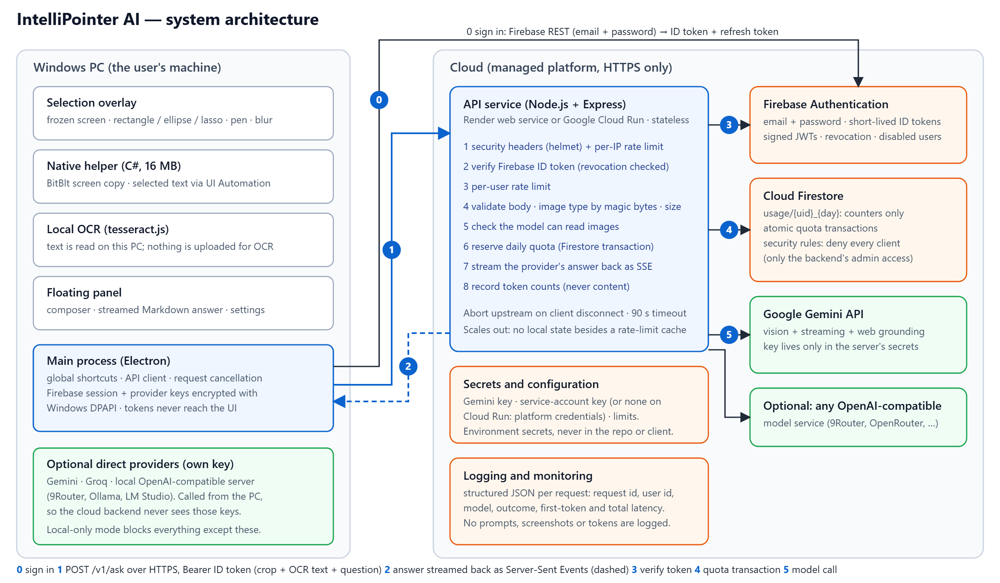
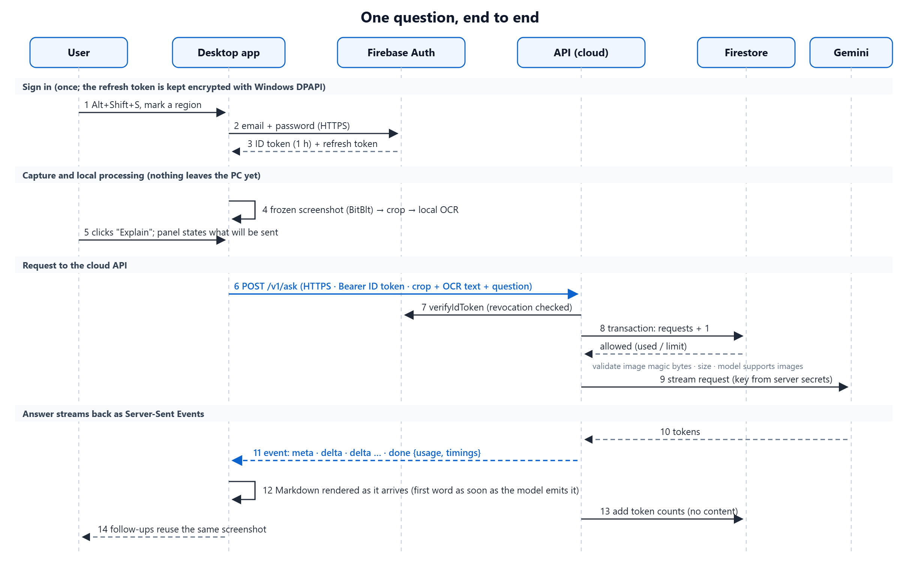

# IntelliPointer AI: A Screen-Aware AI Assistant on a Secure Cloud Backend

**Cloud Computing Lab: Mini-Project**
Fr. Conceicao Rodrigues College of Engineering, Department of Computer Engineering

| Item | Details |
|---|---|
| Students (roll no.) | Ahamed Wafiq (10705), Sai Balkawade (10707), C. Jace Jaison (10711) |
| Project title | IntelliPointer AI: A Screen-Aware AI Assistant on a Secure Cloud Backend |
| Guide | Dr. Vijay Shelke, Department of Computer Engineering |
| Date of submission | 27 October 2026 |
| Source code | https://github.com/WillyEverGreen/Intelli-Pointer-AI |

> **How to finish this report.** Sections marked _fill in_ or "to be completed after deployment" need your own details: names, the evidence produced by `npm run verify:deployment` on your deployed service, and screenshots. Everything else describes the system as built and tested. Rebuild the PDF with `npm run report` in `desktop/`.

## Where each rubric criterion is addressed

| Criterion | Where | Evidence |
|---|---|---|
| **R1** Problem definition and planning | §1 Problem statement, §2 Objectives, §3 Planning (work breakdown, milestones, risks) | Measurable objectives, each tied to a result in §8 |
| **R2** Cloud service selection and architecture | §4 Service selection (with alternatives considered), §5 Architecture, scalability analysis | Architecture and sequence diagrams; `docs/DEPLOYMENT.md` |
| **R3** Implementation and execution | §6 Implementation, §8 Testing and results | 26 backend tests including real Firebase emulators; deployment verifier; measured latency |
| **R4** Security in application and cloud | §7 Security, `docs/SECURITY.md` | Every control mapped to code and to an automated test |
| **R5** Report and documentation | This report, `README.md`, `desktop/README.md`, `docs/DEPLOYMENT.md`, `docs/SECURITY.md` | |

---

## 1. Problem statement

### 1.1 The problem

Getting an AI answer about something on screen is slow and breaks concentration. The usual routine is:

1. take a screenshot,
2. crop it,
3. open a chatbot website,
4. paste the image,
5. retype the context,
6. wait, then
7. switch back to the original application.

For a student reading a paper, an engineer debugging an error dialog, or anyone comparing two charts, this is seven manual steps for one question.

### 1.2 Why this needs a cloud solution

Putting the AI call directly in a desktop program creates three problems that only a cloud design solves:

- **Secrets.** Model APIs need keys. A key inside a distributed program can be extracted, and then anyone can spend the owner's money.
- **Identity and fairness.** Without a server there is no way to know who is calling or to limit how much each person can use, so one user (or one script) can exhaust the quota for everyone.
- **Elasticity and operations.** Model traffic is bursty. A managed, stateless service can scale with demand, and it gives one place to monitor latency and failures.

### 1.3 Scope

**In scope.** A Windows desktop application (select a screen region or text, ask, get a streamed answer in a floating panel) and a cloud API that authenticates users, enforces per-user quotas, validates input, routes to an AI model with vision, and streams the answer back.

**Out of scope.** A mobile or web client, training models, storing conversations or screenshots in the cloud (deliberately excluded for privacy), and billing.

### 1.4 Stakeholders

| Stakeholder | Need |
|---|---|
| End user | One shortcut from seeing something to an answer, with clear control over what is sent |
| Service owner | No leaked keys, bounded cost, visibility into usage and failures |
| Evaluator | Clear architecture, working system, evidence of security and testing |

## 2. Objectives

Each objective is measurable and is checked in §8.

| # | Objective | Success measure |
|---|---|---|
| O1 | Shortcut → selection overlay → finished crop, fast | Overlay on screen in under 100 ms; crop ready in under 1 s (§8.3) |
| O2 | Mark exactly what to ask about | Rectangle, ellipse, lasso, pen, arrow, highlight and blur tools; several regions per question |
| O3 | Understand text and images | Local OCR plus a vision-capable model; follow-up questions reuse the screenshot |
| O4 | Stream answers into a floating panel | First tokens render as they arrive; stop, retry and copy work |
| O5 | Secure, authenticated cloud API | Every request needs a verified identity; limits and validation enforced |
| O6 | Per-user usage control in the cloud | Quota never exceeded, even under concurrent requests |
| O7 | Privacy by design | No screenshots or prompts stored or logged; the user is told what is sent |
| O8 | Measurable performance | Capture, OCR, upload, first-token and total latency recorded |
| O9 | Lightweight client | Low memory and idle CPU |
| O10 | Reproducible deployment and tests | One-command verification of a deployed service; automated test suites |

## 3. Project planning

### 3.1 Approach and workflow

The system was built in vertical slices, each ending in something testable, rather than layer by layer:

1. **Desktop shell and capture** (global shortcut, transparent overlay, frozen screenshot).
2. **Annotation tools and cropping** (shapes, masking, blur; crops at physical resolution under any display scaling).
3. **Local processing** (OCR, thumbnails, a "what will be sent" notice).
4. **AI integration** (provider abstraction, streaming, follow-ups).
5. **Cloud backend** (authentication, quotas, validation, provider routing, SSE).
6. **Cloud deployment and verification** (Firebase, Render or Cloud Run, verification script).
7. **Hardening and performance** (security review, dependency audit, latency and memory work).
8. **Documentation and evaluation** (architecture, security and deployment documents, this report).

### 3.2 Work breakdown and deliverables

| Phase | Work | Deliverable | Verified by |
|---|---|---|---|
| 1 | Electron shell, global shortcuts, tray | App starts in the tray; shortcut opens the overlay | Electron tests |
| 2 | Drawing tools, regions, masks, blur | Overlay with all tools | Overlay test at 1.5× scaling |
| 3 | Crops, OCR, privacy notice | Panel shows thumbnails, OCR text, what is sent | UI test |
| 4 | Providers, streaming, follow-ups | Streamed answers, retry, stop, follow-up | Live test with a real model |
| 5 | Express API, Firebase Auth, Firestore quotas | `backend/` | 13 unit and 13 emulator tests |
| 6 | Render / Cloud Run deployment, verifier | `render.yaml`, `Dockerfile`, `verify-deployment.mjs` | Verifier output (§8.4) |
| 7 | Security review, audit, performance | `docs/SECURITY.md`, 0 vulnerabilities, latency table | §7, §8 |
| 8 | Documentation | README files, guides, this report | Review |

### 3.3 Risks and mitigations

| Risk | Likelihood | Impact | Mitigation | Outcome |
|---|---|---|---|---|
| Model provider is slow or overloaded | High | User-visible delay | Streaming, clear loading and error states, retry, a fast model by default, a speed test per model | Observed: 3 s to 20 s time-to-first-token depending on provider load (§8.3) |
| Leaked provider key | Medium | Cost, abuse | Keys only in server secrets; none in the client; no key file on Cloud Run | No secret in the repository (checked before every commit) |
| Cost or abuse by a single user | Medium | Quota exhaustion | Auth + per-user daily quota + rate limits | Verified under a 12-request burst (§8.2) |
| Capture differs across Windows display scaling | Medium | Wrong crops | Capture in physical pixels; tested at 1.5× scaling | Test passes |
| Free-tier cold starts | High | First request is slow | Documented; health check endpoint; Cloud Run `min-instances` option | Measured by the verifier |
| Cloud account unavailable (billing) | Medium | Cannot deploy to Google Cloud | Two targets: Render (free) and Cloud Run | Both documented |

### 3.4 Tools and technology

Electron (desktop shell), plain JavaScript (no build step, fast start), a small C# native helper for Windows APIs, Node.js 22 with Express, Firebase Authentication and Cloud Firestore, Google Gemini API, Render or Google Cloud Run, Docker, GitHub Actions (CI), tesseract.js (local OCR), Lucide (icons).

## 4. Cloud service selection

### 4.1 Selected services and why

| Need | Service | Why this one |
|---|---|---|
| User identity | **Firebase Authentication** | Managed sign-in and short-lived signed ID tokens (JWT, one hour) that the API verifies with Google's public keys. No password database to build or protect. Supports revocation and disabling users. |
| Per-user usage and quotas | **Cloud Firestore** | A serverless document database with **transactions**, so "check the quota and add one" is atomic and concurrent requests cannot exceed the limit. Scales without servers to manage. Only counters are stored. |
| Running the API | **Render web service** (free) or **Google Cloud Run** | Managed HTTPS and certificates, deploy from Git or a container, secret environment variables, health checks. Cloud Run additionally scales instances automatically, supports least-privilege service accounts, and removes the need for any key file. |
| AI inference | **Google Gemini API** (optional: any OpenAI-compatible service) | Vision input, token streaming and web grounding in one API. Called only from the backend, so the key never reaches users. |
| Secrets | Host secret environment variables; **Secret Manager** on Cloud Run | The only place a key exists. |
| Observability | Platform logs and structured JSON logs | One line per request with request id, user id, model, outcome and latencies. No content. |

### 4.2 Alternatives considered

| Decision | Alternative | Why not chosen |
|---|---|---|
| Identity | Build our own login (database + password hashing + session tokens) | More code and more attack surface for no benefit; easy to get wrong |
| Identity | AWS Cognito / Azure AD B2C | Comparable, but Firebase integrates directly with Firestore rules and Google tooling, and has a free tier suited to a student project |
| Quota store | A relational database | A heavier service to run for a handful of counters; Firestore transactions give exactly the atomicity needed |
| Quota store | In-memory counters | Lost on restart and not shared between instances (kept only as a local-development fallback) |
| Conversation storage | Store chats in Firestore | Rejected on privacy grounds: it would mean storing screenshots and prompts. The client keeps conversations in memory only |
| Compute | Virtual machine | More to patch and secure, no automatic scaling or managed TLS |
| Compute | Cloud Functions | Long-lived streaming responses fit a container service better |
| AI | Calling the model from the desktop app | Would put the provider key in the client |

We did not add services for their own sake: there is no message queue, cache or extra database because no requirement needs one.

### 4.3 Cost awareness

All chosen services have free tiers sufficient for development and a demonstration (check the current limits on the providers' pricing pages before relying on them). Cost is also *bounded by design*: the daily quota caps requests per user, request size is limited, upstream calls time out, and Cloud Run offers `--max-instances` as a hard ceiling.

## 5. Architecture



*Figure 1. System architecture. Numbered flows: 0 sign in, 1 request, 2 streamed response, 3 token verification, 4 quota transaction, 5 model call.*

### 5.1 Components

**Windows client (Electron).**
- The *main process* owns the shortcuts, the API client, request cancellation, and the encrypted Firebase session and provider keys (Windows DPAPI).
- *Overlay windows* (one per display) draw the selection tools over a frozen screenshot.
- The *panel* shows the conversation, the model menu and settings.
- A 16 MB *native helper* provides fast screen copies and reads selected text.
- *Local OCR* runs on the PC.
- Renderers are sandboxed and see no tokens or keys.

**API service (Node.js + Express), stateless.** Per request: security headers and a per-IP rate limit → verify the Firebase ID token (with revocation check) → per-user rate limit → validate the body and images (file signature, size, count) → check the model can read images → reserve the daily quota in a Firestore transaction → stream the provider's answer as Server-Sent Events → record token counts → log the outcome.

**Firebase Authentication.** Issues and verifies identity tokens.

**Cloud Firestore.** One small document per user per day, `usage/{uid}_{YYYY-MM-DD}`, holding only counters. Security rules deny every client; only the backend's admin access reads or writes.

**AI provider.** Gemini through its official streaming API, behind a provider registry that also accepts any OpenAI-compatible endpoint.

### 5.2 One question, end to end



*Figure 2. Sequence of one question: sign in, local capture and OCR, authenticated request, quota transaction, streamed answer.*

### 5.3 Data model

| Store | Content | Retention |
|---|---|---|
| Firestore `usage/{uid}_{day}` | `uid`, `day`, `requests`, `inputTokens`, `outputTokens`, `lastProvider`, `lastModel`, `updatedAt` | Per day; no content |
| Desktop `%APPDATA%` | Non-secret settings; DPAPI-encrypted session and provider keys; a timings-only CSV and diagnostics log | Until the user clears it |
| Anywhere | Screenshots, OCR text, prompts, answers | **Never stored**; in memory until the conversation is cleared |

### 5.4 Scalability and availability

- **Horizontal scaling.** The API keeps no session state (identity is in the token, quota in Firestore), so any number of instances can serve any request. Cloud Run adds instances automatically with load.
- **Atomic shared state.** The quota is a Firestore transaction on one small document per user-day, so instances never disagree. A single document sustains roughly one write per second, which is far above one user's request rate.
- **Streaming.** Responses are Server-Sent Events, so the user sees text as soon as the model produces it; the server aborts the upstream call if the client leaves.
- **Failure handling.** Upstream errors become a retryable SSE error event; the client can retry or switch model; health checks let the platform restart a failing instance; a 90-second upstream timeout prevents hung requests.
- **Known scaling limit.** The per-minute rate limiter is per instance (in memory). The daily quota, which bounds cost, is global. A shared limiter is the next step for large deployments (§9).

## 6. Implementation

### 6.1 Repository layout

```
backend/    Express API, tests, emulator integration test, deployment verifier, Dockerfile
desktop/    Electron app (main process, renderers, native helper, installer scripts, tests)
firebase/   Firestore security rules      firebase.json   Emulator configuration
docs/       Architecture, security and deployment documents, this report
render.yaml Render blueprint              .github/workflows/ci.yml   Continuous integration
```

### 6.2 Cloud API

| Endpoint | Auth | Purpose |
|---|---|---|
| `GET /healthz` | none | Liveness; whether providers and Firestore are configured |
| `GET /v1/models` | Bearer | Models with capability flags (vision, web search) |
| `GET /v1/usage` | Bearer | The caller's usage and limit for today |
| `POST /v1/ask` | Bearer | Streams SSE events `meta`, `delta`, `sources`, `done`, `error` |

Key design points: Firebase tokens are verified on every request with revocation checking; the daily quota is reserved in a transaction before any model is called; images are validated by file signature; the provider layer is an abstraction (`gemini`, OpenAI-compatible) with per-model capability checks; logs contain identifiers, counts and timings only.

### 6.3 Desktop application

| Feature | How |
|---|---|
| Overlay appears instantly | Pre-created transparent overlays are shown at once; the screenshot is taken behind them (they are excluded from capture) and swapped in as a frozen background |
| Correct under any display scaling | Capture and crops in physical pixels; tested at 1.5× scaling |
| Selection tools | Rectangle, square, ellipse, lasso, pen, arrow, highlight, blur; several regions per question; undo and redo; mask outside shapes |
| Selected-text questions | A native helper reads the selection through UI Automation, with a Ctrl+C fallback that restores the clipboard |
| Commands and shortcuts | Built-in and user-defined commands, optional per-command shortcuts, pinned to the toolbars; a recorder that checks shortcuts against other applications |
| Model sources | Gemini or Groq with the user's own key, any OpenAI-compatible server (9Router, Ollama, LM Studio), or this project's cloud API; a model menu with image support and measured speed |
| Privacy | A notice before every send, a blur tool, a local-only mode, nothing written to disk |

### 6.4 Performance engineering

Measured on a 1920×1080 display at 125 % scaling.

| Change | Effect |
|---|---|
| Show the overlay first, capture behind it | Overlay on screen in 5–39 ms instead of waiting for the capture |
| Screen copy through GDI BitBlt in a native helper | Screenshot in 109–338 ms; Electron's built-in grabber took up to 2.8 s after the app had been idle |
| Compiled C# helper instead of a PowerShell host | 16 MB instead of about 127 MB; ready in about 100–400 ms |
| Software rendering by default | About 100 MB less memory with no visible difference for this interface |
| OCR engine loaded on demand and unloaded after idle | No cost until a capture is started |

## 7. Security

The full control-by-control analysis, with the code location and the test that proves each control, is in `docs/SECURITY.md`. Summary:

| Area | Controls |
|---|---|
| **Authentication** | Firebase ID token required for every `/v1/*` call; signature and revocation verified; disabled and revoked users refused immediately |
| **Authorization** | Quota and usage keyed by the verified user id; Firestore rules deny all client access, including a user reading or resetting their own quota |
| **Secrets** | Gemini key and service account only in server secrets; none in the repository or the client; no key file at all on Cloud Run; user keys encrypted with Windows DPAPI |
| **Input validation** | Size, count and length limits; images checked by file signature (a fake PNG is rejected); a model that cannot read images never receives one |
| **Abuse and cost control** | Per-IP and per-user rate limits; daily quota in an atomic transaction; upstream timeout; upstream cancelled when the client disconnects |
| **Transport and platform** | HTTPS only (the client refuses non-HTTPS backends except localhost); `helmet` security headers; non-root container; 0 known vulnerabilities in production dependencies, enforced in CI |
| **Privacy** | Nothing stored or logged: no screenshots, OCR text, prompts or tokens; users are told what will be sent; a blur tool and local-only mode |
| **Client hardening** | Sandboxed renderers, context isolation, strict content-security policy, tokens never reach the UI |
| **Safe development mode** | The authentication bypass used for local work is refused in production or on a public interface |

A STRIDE threat model and an honest list of remaining limitations (per-instance minute limiter, no App Check, no email verification, unsigned installer) are in `docs/SECURITY.md`.

## 8. Testing and results

### 8.1 Test strategy

| Level | What | Command | Count |
|---|---|---|---|
| Backend unit | Validation (magic bytes, limits, roles), authentication enforcement, security headers | `npm test` | 13 |
| **Backend integration (real Firebase emulators)** | Real token verification, Firestore transactions and security rules, SSE streaming, rate limits, cancellation, log redaction | `npm run test:emulator` | 13 |
| Deployment verification | The same kind of checks against a live URL | `npm run verify:deployment` | 12 checks |
| Desktop unit | SSE parser, compiled helper (startup, screen grab, memory) | `npm test` | 3 |
| Desktop UI and end to end | Overlay tools and crops, panel and settings, selected text and clipboard, capture speed, a live model conversation, providers | `npx electron test/*.e2e.js` | 6 suites |
| Static | Syntax check of every file; dependency audit | `npm run check`, `npm audit` | 41 files; 0 vulnerabilities |
| Continuous integration | All of the above on every push | GitHub Actions | |

### 8.2 Functional results (backend, real emulators)

| Property tested | Result |
|---|---|
| Requests without a valid Firebase token are refused | Passed (401) |
| A real emulator-issued token is accepted; models listed with capabilities | Passed |
| `/v1/ask` streams `meta, delta…, done` with token usage, and records usage in Firestore | Passed; only counters are stored |
| **Quota under concurrency:** 12 parallel requests with a limit of 5 | **Exactly 5 allowed and 7 refused; the counter never overshoots** |
| One user's quota does not affect another's | Passed |
| Revoked sessions and disabled accounts are refused at once | Passed |
| Image on a text-only model, oversized image, unknown model | Refused with the right errors |
| Upstream failure | Retryable SSE error event |
| Client disconnects | The upstream request is cancelled |
| Per-user rate limit | 429 after the limit, independent of the daily quota |
| Logs never contain prompts or tokens | Passed |
| Firestore rules deny every client read and write | Passed, including a user's own document |

### 8.3 Performance results

| Measurement | Result |
|---|---|
| Shortcut → overlay on screen | 5–39 ms |
| Shortcut → screenshot frozen | 109–338 ms |
| Shortcut → finished crop (including a cold round after 15 s idle) | 228–519 ms across all measured runs |
| Local OCR of a small code snippet | 0.7–1.3 s |
| Upload size for a crop, OCR text and question | about 3 KB |
| Backend time before the model call (auth, validation, quota) | about 1 ms locally with in-memory quota; _fill in with Firestore from the deployed service_ |
| Time to first token (varies a great deal with provider load) | 0.7 s with a lightweight Gemini model through the backend in one run; 3 s to 20 s in other runs, including a period when the provider returned "high demand" errors, which the app shows as a retryable error |
| Desktop app memory at idle (private) | about 183 MB in total (app about 167 MB, native helper 16 MB); before the optimisations about 397 MB (app about 270 MB with GPU acceleration, PowerShell helper about 127 MB) |
| Desktop idle CPU | 0.1–0.3 % |

Interpretation: the client-side work (capture, OCR, upload) takes well under a second; almost all waiting is model inference at the provider, which varies with load. Streaming and a per-stage timing line make that visible instead of hiding it.

### 8.4 Deployment evidence (to be completed after deployment)

Run `npm run verify:deployment` (see `docs/DEPLOYMENT.md`), then paste the generated table and add the screenshots:

| Item | Source |
|---|---|
| Verifier table (HTTPS, health, security headers, 401 checks, sign-in, streamed answer with latency, usage counter, 415 and 413 checks) | `docs/evidence/deployment-<time>.md` |
| Firebase Authentication → Users | _screenshot_ |
| Firestore → `usage` documents (counters only) | _screenshot_ |
| Render or Cloud Run dashboard and request logs | _screenshot_ |
| The desktop app answering through the deployed backend | _screenshot_ |

## 9. Limitations and future work

- The per-minute rate limit is per instance; a shared limiter would be needed at large scale.
- Firebase App Check, email verification and sign-in with Google are not enabled.
- The free Render tier sleeps when idle, so the first request after a pause is slow; Cloud Run with `--min-instances 1` avoids this.
- The Windows installer is not code-signed.
- Model latency is outside our control; a lighter model or a nearer region helps.
- Future: shared rate limiting, an admin dashboard for usage, more providers through the existing registry, Windows' built-in OCR engine.

## 10. Conclusion

IntelliPointer AI reduces "see something, get an answer" to one shortcut, one drag and one click, and shows the answer in a floating window without switching applications. The cloud side demonstrates a secure design built from managed services: Firebase Authentication for identity, Firestore transactions for a quota that cannot be exceeded even under concurrent load, a stateless HTTPS API on Render or Cloud Run that scales out, and secrets that never leave the server. Security is built in at every layer and each control is backed by an automated test, including integration tests against the real Firebase emulators. Privacy is a design rule, not an option: nothing a user captures or asks is stored or logged. Performance work brought the shortcut-to-crop time to roughly a quarter to a half second and cut the desktop footprint from about 397 MB to about 183 MB.

## 11. References

1. Firebase Authentication and the Admin SDK (`verifyIdToken`). <https://firebase.google.com/docs/auth>
2. Cloud Firestore transactions and security rules. <https://firebase.google.com/docs/firestore>
3. Firebase Local Emulator Suite. <https://firebase.google.com/docs/emulator-suite>
4. Google Cloud Run documentation. <https://cloud.google.com/run/docs>
5. Secret Manager. <https://cloud.google.com/secret-manager/docs>
6. Render documentation, including Blueprint specification. <https://render.com/docs>
7. Gemini API: streaming, image input, Google Search grounding. <https://ai.google.dev/gemini-api/docs>
8. Electron documentation: security checklist, performance, `safeStorage`. <https://www.electronjs.org/docs/latest>
9. OWASP API Security Top 10 (2023). <https://owasp.org/API-Security/>
10. Tesseract.js. <https://github.com/naptha/tesseract.js>
11. Lucide icons. <https://lucide.dev>

---

## Appendix A. Using the application

| Do this | Result |
|---|---|
| **Alt+Shift+S** | Freeze the screen; drag to select a region (several allowed); Enter to ask |
| **Alt+Shift+A** | Ask about the text selected in any application |
| Select text in any app | An Ask bar appears next to it with your pinned commands |
| Settings → Models | Choose sources (Gemini, Groq, local server, cloud) and which models appear in the model menu |
| Settings → Commands | Add your own prompts, pin up to four, give any of them a shortcut |
| Settings → Shortcuts | Click a shortcut and press the keys; it is checked against other apps |

## Appendix B. Human–computer interaction design (reusable for the HMI mini-project)

- **Fitts's law:** the panel opens next to the selection; commands are one click away; the toolbar moves away from the cursor.
- **Hick's law:** a few pinned commands in the toolbars, the full set in the panel.
- **Immediate feedback:** the overlay is on screen in milliseconds; a status chain shows recognising text, uploading, streaming and finished timing.
- **Error prevention and recovery:** undo and redo, Escape everywhere, Retry, Stop, and a notice before anything is sent.
- **User control:** pin, collapse, local-only mode, choose whether the image or only the text is sent, choose which models and shortcuts appear.
- **Does not steal focus:** commands run without taking the keyboard from the application being read.

Usability test plan (5–8 participants): three tasks (explain an error message, compare two charts, translate a paragraph), each done the manual way (screenshot → chatbot → paste → type) and with IntelliPointer. Record completion time, errors and a System Usability Scale questionnaire. SUS score = 2.5 × (Σ(odd item − 1) + Σ(5 − even item)); above 68 is above average.
